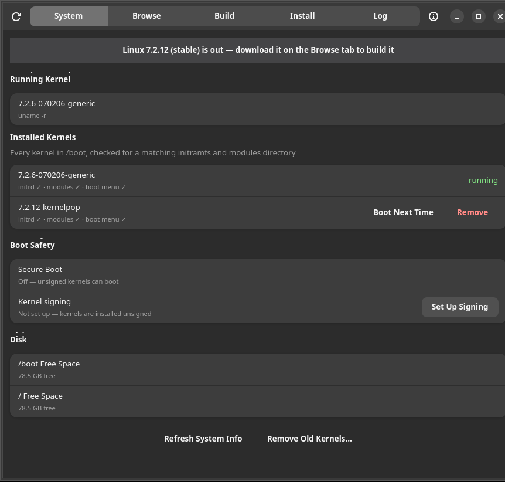
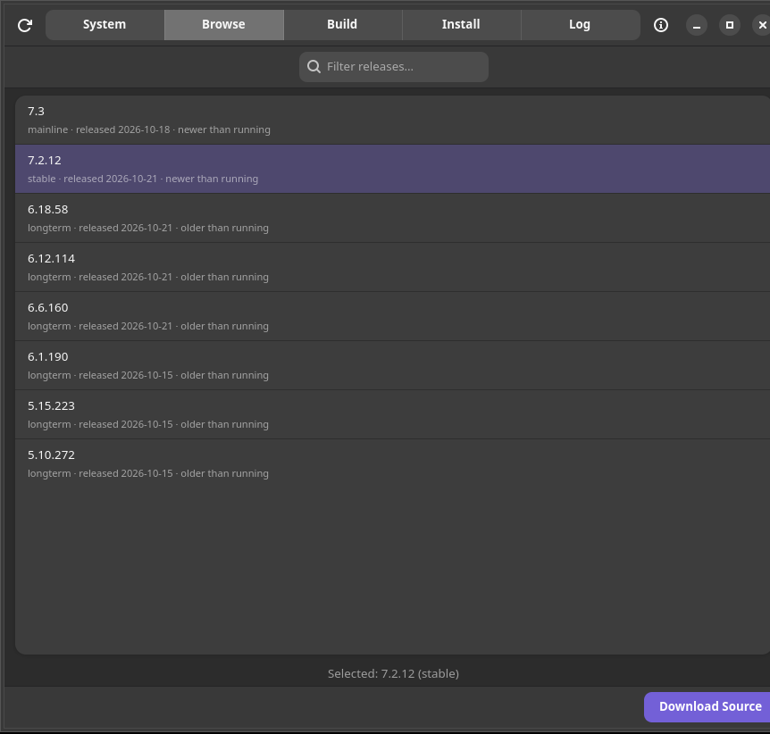
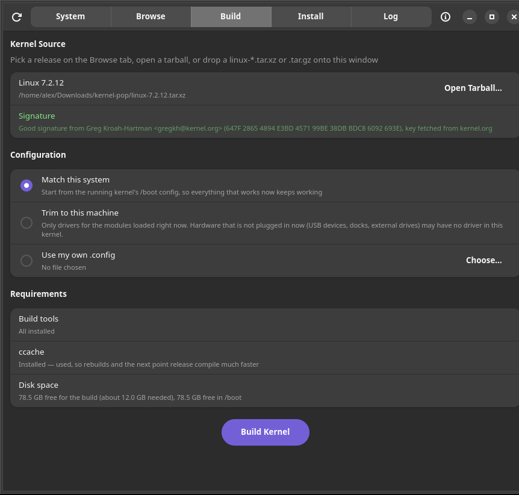
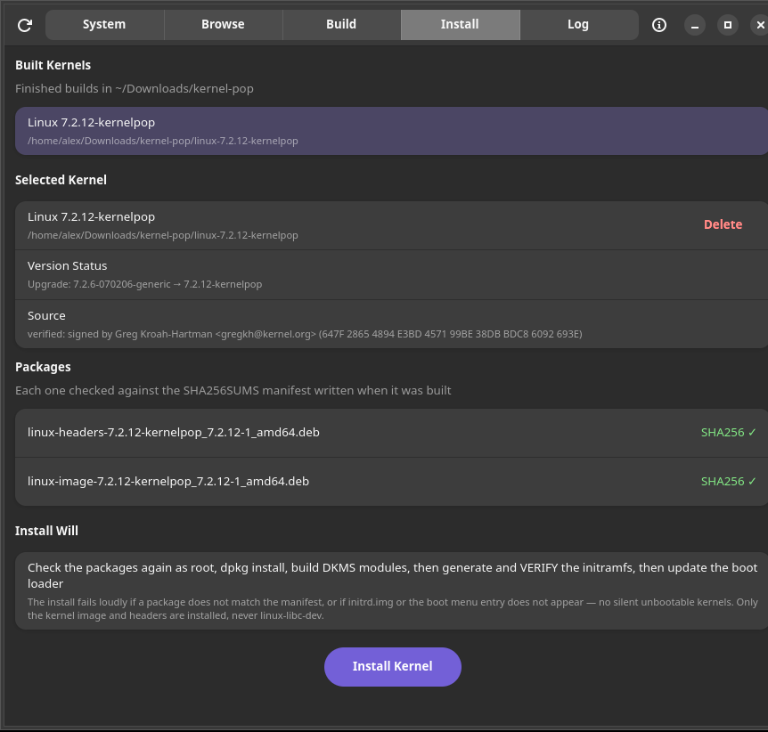
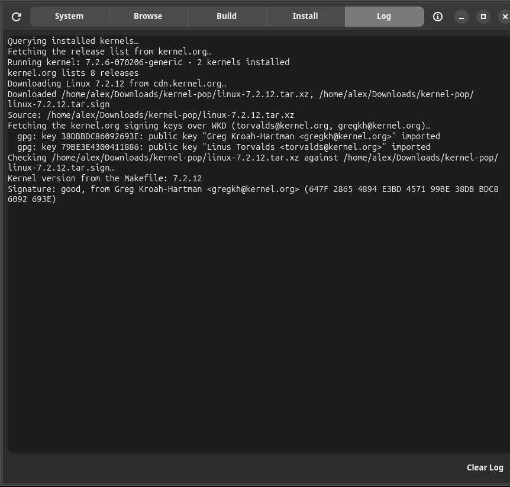

# Kernel Pop

GTK4 + libadwaita desktop app, written in Rust, that builds kernel.org
kernels for this machine and installs them. Distributed as an AppImage.

Pick a mainline, stable or longterm release on the Browse tab (or drop a
`linux-*.tar.xz` / `.tar.gz` onto the window). Kernel Pop checks the
tarball's signature against the kernel.org developers' keys, configures it
from the configuration of the kernel you are running, builds Debian
packages with `make bindeb-pkg` as your own user, and installs them with
the same safety checks as always. See [docs/SOURCE_BUILD.md](docs/SOURCE_BUILD.md)
for the details.

## Why this exists

Kernel tools have a habit of installing a kernel without generating its
initramfs, because they parse the kernel version out of a filename and an
unexpected naming convention breaks the parse. The result is a kernel that
VFS-panics on boot. This app is built around not letting that happen:

- The kernel version is read from the source's Makefile and the .deb
  package metadata, never from filenames, and cross-checked against the
  /lib/modules directory that actually appears after install.
- The initramfs is generated and then VERIFIED to exist in /boot before
  the install reports success. A missing initrd fails the install loudly.
- The System tab health-checks every installed kernel for a missing
  initrd, modules directory, or boot menu entry, so a broken kernel is
  visible before a reboot instead of after.
- Works with GRUB, systemd-boot and kernelstub, detecting whichever one is
  actually active on the machine.

## Features

- Browse kernel.org's current mainline, stable and longterm releases with
  newer/same/older badges relative to the running kernel, an EOL badge on
  end-of-life longterm releases and a search filter, and a banner on the
  System tab when a newer stable release is out
- Download a release's tarball and signature from cdn.kernel.org with
  progress, retries and cancellation, or open or drop a tarball you already
  have
- Every source is verified before it is built: the signature must be a good
  one from a kernel.org developer (Linus Torvalds or Greg Kroah-Hartman),
  whose key is fetched from kernel.org over WKD each time. A dropped tarball
  without its `.tar.sign` gets kernel.org's fetched. When fetching the keys
  or the signature fails, Check Again on the Build tab tries again. A missing or bad
  signature blocks the build; for your own patched tree there is one
  explicit "Build unverified source" switch per tarball, and the build log
  says the source was unverified. Mainline release candidates have no
  published signature, so building one needs that switch
- Three configurations: **Match this system** (the default: the running
  kernel's `/boot/config-*`), **Tuned for this machine** (only drivers for
  the hardware in this computer plus the kinds people plug in, such as USB
  storage, controllers, headsets, webcams, docks and VPN/container
  networking; about a third of the build time) and **Use my own .config**. The fixes every
  Ubuntu config needs for a kernel.org tree are applied automatically, and
  a summary is shown before the build starts
- Builds never run as root. Missing build tools are listed and installed
  with one authentication; ccache is used when installed
- Live build stage and elapsed time, the output in the Log tab and in
  `build.log`, and a Cancel button that stops the whole build
- Only the kernel image and headers packages are installed, never the
  `linux-libc-dev` package bindeb-pkg also builds. The install step checks
  every package again as root on a private copy, against the manifest the
  build wrote
- Remove old kernels (running kernel is never removable), singly or
  "keep the newest N" in one step. Kernels from other sources, such as
  Ubuntu's own, are shown and managed the same way
- Boot a chosen installed kernel on the next restart only
- Sign a single installed kernel with Kernel Pop's key from its row on the
  System tab, once signing is set up
- With Secure Boot on, a kernel that could not boot is never installed:
  the install is refused until signing is set up, and a kernel whose
  signing fails is removed again
- Optional kernel signing: a one-time Set Up Signing step creates Kernel
  Pop's own signing key, signs the installed kernels and queues the key for
  MOK enrollment; from then on every kernel it installs is signed
  automatically, with a Signed / Signed by Ubuntu / Unsigned badge per
  kernel
- DKMS modules (such as NVIDIA) are built for the new kernel and reported
  per module; a failure is a warning, not an install error
- When a software update (GNOME Software, unattended upgrades) is using
  the package manager, installs, removals and the build tools wait for it
  to finish, up to 30 minutes, and say which program they are waiting for
- Disk space checks for the build, / and /boot
- Install log in-app plus /var/log/kernel-pop.log

## Requirements

An x86_64 Debian- or Ubuntu-based system (apt and dpkg: Kernel Pop builds
`.deb` packages and installs them with dpkg) with polkit, booting with GRUB,
systemd-boot or kernelstub (Pop!_OS). Kernel signing needs UEFI.

## Install

Download the AppImage from the Releases page:

    chmod +x kernel-pop-*-x86_64.AppImage
    ./kernel-pop-*-x86_64.AppImage

First launch asks for authentication once to install the privileged
helper script and the polkit policy to system paths. A new version asks
once more to update them. If that authentication is cancelled, the app
still opens but shows a banner, and installing, removing and signing
kernels stay off until you restart it and authenticate.

### Updating

Each release ships a `.zsync` file next to the AppImage, and the AppImage
carries its update information, so AppImageUpdate updates it in place.
Downloading the new AppImage works too. Its first launch asks for
authentication once to update the helper.

### Uninstalling

Delete the AppImage, then the files Kernel Pop put on the system:

    sudo rm -rf /usr/lib/kernel-pop
    sudo rm -f /usr/share/polkit-1/actions/io.github.labj1987.KernelPop.policy /var/log/kernel-pop.log
    rm -rf ~/.cache/kernel-pop ~/Downloads/kernel-pop

`/var/lib/kernel-pop/` holds the signing key (`mok/`) and signing state.
Keep it while kernels signed with that key are installed and Secure Boot is
on: those kernels need the enrolled key, not the file, to boot, but you need
the file to sign new ones. Remove it with `sudo rm -rf /var/lib/kernel-pop`
once you no longer use Kernel Pop's kernels. `/var/lib/mok-pending/` is
shared with other apps that queue Secure Boot keys; remove it only if none
is left. Kernels it installed are
ordinary packages: remove them on the System tab first, or with apt.

## Using it

1. The System tab shows the running kernel and the health of every
   installed kernel.
2. Pick a release on the Browse tab and hit Download Source (it lands in
   `~/Downloads/kernel-pop/`), or open or drop a tarball. The Build tab
   shows its version and whether its signature checked out.
3. On the Build tab, choose a configuration, install any missing build
   tools, and hit Build Kernel. Check the summary, then confirm. A build
   takes a while; the finished packages go to
   `~/Downloads/kernel-pop/linux-<version>-kernelpop/` with the final
   config, the build log, `build-info.txt` and a `SHA256SUMS` manifest, and
   the build tree is deleted.
4. Review the build on the Install tab and hit Install Kernel, or Delete a
   build you no longer need.
5. Reboot when ready, or use Boot Next Time on the System tab to try it
   once while keeping your current default. The new kernel only reports
   success after its initramfs is verified on disk.

## Screenshots

**System** — every installed kernel with initrd/modules/boot-menu health checks, a running badge, Secure Boot and signing state, disk space, and a banner when a newer stable release is out

**Browse** — kernel.org's mainline, stable and longterm releases, badged against the running kernel

**Build** — the source and its signature check, the configuration mode, and the build tools, ccache and disk space it needs

**Install** — finished builds, each package checked against its manifest, and the install action

**Log** — the run log, from the release list through the signature check (the last 6000 lines; the full build output is in `build.log`)

## Notes

Developed and tested on Ubuntu 26.04, GNOME on Wayland.

### Secure Boot and kernel signing

Kernels built from source are unsigned. With Secure Boot enforcing, shim
refuses to boot an unsigned kernel, so they need Kernel Pop's signing setup
(or Secure Boot turned off) before they can boot:

1. On the System tab, Kernel signing → **Set Up Signing**. Choose a
   one-time password: 8-16 printable ASCII characters, no spaces (MOK
   Manager reads it with a US keyboard layout). Setting up again replaces
   it, and a password chosen earlier, here or in another app, stops working.
   A waiting request that holds anything setup can't carry over (a hash
   entry, or an entry it can't read) is left alone: finish it at the next
   reboot, then set up again. If the new request can't be written, setup
   tries once more; if that fails too, the log names every key that is no
   longer waiting, with its SHA1 fingerprint, and you run Set Up Signing
   again.
   Kernel Pop installs `sbsigntool`,
   `openssl` and `mokutil` if they are missing, creates a key in
   `/var/lib/kernel-pop/mok/`, signs every installed kernel and queues the
   key for enrollment, together with the DKMS module-signing key (what the
   NVIDIA driver is signed with) and any key another app already queued:
   shim keeps one request with one password, so they all go in one request
   under the password you chose here.
2. Reboot. A blue MOK Manager screen appears: choose Enroll MOK, Continue,
   Yes, and type the password once. It enrolls all the keys.
3. Back in Linux, check that the System tab shows the keys as enrolled,
   and only then turn Secure Boot on.

Only root can read the waiting request, so setup writes the keys it queued
to `/var/lib/mok-pending/list`, a list shared with other apps that queue
keys in the same request. The System tab trusts it only while the request
is unchanged since then: once the keys are enrolled at boot, or the request
is replaced by other means, the list is ignored, and an enrolled key always
shows as enrolled. If the EFI variables are not mounted (some chroot tools
unmount them on exit), the System tab says so, and Set Up Signing and the
install mount them before they look at the keys.

From then on every kernel Kernel Pop installs is signed (`sbsign`, then
`sbverify` before the image in `/boot` is replaced), whether Secure Boot is
on or off. With Secure Boot off, a signing failure is a `SIGN WARNING` in
the log, not an install failure; with it enforcing, the kernel is removed
again (below). Signing adds a signature, so a kernel already signed by
Ubuntu keeps its original one too; Ubuntu's own kernels show "Signed by
Ubuntu" and boot under Secure Boot without the setup. Kernel Pop uses its
own key rather than Ubuntu's module-signing MOK, which shim does not accept
for kernels. Without the setup, kernels are installed unsigned when Secure
Boot is off; with it on, the install is refused (below).

With Secure Boot enforcing, Kernel Pop only installs a kernel that will be
signed with a key that is enrolled or waiting for enrollment:

- Without the signing setup, or with a key that is neither enrolled nor
  queued (or whose state mokutil cannot report), the install is refused
  before anything changes, and the app points you to Set Up Signing.
- If signing the new kernel fails, its packages are removed again, so no
  kernel that shim would refuse is left in the boot menu.
- If the key is still waiting for enrollment, the kernel is installed and
  signed, and the install reminds you to confirm the enrollment at the MOK
  Manager screen on the next reboot; skip that and it will not boot.

With Secure Boot off, every kernel installs; one that could not be signed
is reported with a `SIGN WARNING`, and boots until Secure Boot is turned
on.

DKMS modules (such as NVIDIA) are signed with Ubuntu's MOK key, as usual.
The kernels Kernel Pop builds keep the options that let a kernel trust
enrolled MOK keys for module signatures (the machine keyring), and the
build summary warns if a configuration turns them off. Under Secure Boot a
DKMS module loads only once that MOK key is enrolled: Set Up Signing queues
it for enrollment together with Kernel Pop's own key, the System tab shows
whether it is enrolled, and with Secure Boot on the install warns when it
is not.

## Building from source

    apt install -y libgtk-4-dev libadwaita-1-dev pkg-config
    cargo build --release --locked

The compiler is pinned in `rust-toolchain.toml` (Rust 1.96.0), which rustup
picks up automatically; a distribution's `cargo`/`rustc` may be older.

Or build the AppImage. An ordinary user is enough once the build
dependencies are installed:

    apt install -y libgtk-4-dev libadwaita-1-dev pkg-config zsync wget file desktop-file-utils
    bash build-appimage.sh

## Acknowledgements

Development assistance: Claude Code (Anthropic) and Codex (OpenAI).

## License

AGPL-3.0-or-later — see [LICENSE](LICENSE).

Code at or before commit `8cb172eb68a8ed7c417ae0f04c4b2adaae858c34` remains available
under the MIT License per its original release. From this commit forward,
AGPL-3.0-or-later.

Linnard Alex Brown Jr.
